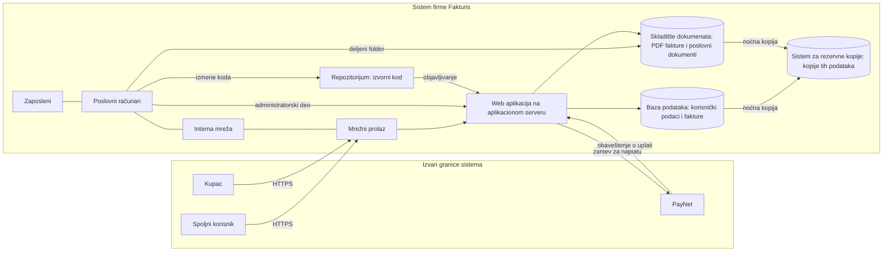

# Handoff: presek posle spajanja sa main

Stanje na dan 30. 10. 2026. Grana `moco-branch` spojena je sa `origin/main` (commiti „Uklonjeni pojmovi” i „Uklanjanje handoff-a i sažetka”).

## Šta je urađeno

Na `main` su obrisane sve beleške iz `pojmovi/` koje su postojale u početnoj bazi, da bi se pojmovi radili iz početka. Ova grana je posle toga, u commitu „Revidirane komponente sistema”, izmenila deo tih beleški i dodala nove.

Pri spajanju prihvaćeno je brisanje svega što je `main` obrisao, uključujući 13 beleški koje je ova grana menjala. Zadržano je 16 beleški koje postoje samo na ovoj grani. Izmene u `konteksti/Fakturis.md` i `_meta/odluke.md` ostaju sa ove grane, jer `main` te fajlove nije dirao.

```
_meta/konfiguracija.md   tema, problem, publika, primarni kontekst
_meta/odluke.md          verzija sa ove grane; deo linkova vodi na obrisane beleške
konteksti/Fakturis.md    verzija sa ove grane; tabela slabosti firme bez linkova ka pojmovima ranjivosti
pojmovi/                 14 beleški (Resurs, Komponenta sistema, 10 komponenti prezentacije 1, i dve koje nisu u izlaganju)
handoff.md               ovaj fajl
```

Ulazi koji su ranije korišćeni za izradu pojmova: `Tema 1 - Kostur.md` i predavanja ZOSS 01, 02 i 03 iz `Materijali/`. `sazetak.txt` je uklonjen 30. 10. 2026. Struktura firme je u [[Fakturis]].

**Primarni kontekst.** Firma *Fakturis d.o.o.* (oko 20 zaposlenih, Novi Sad) razvija web aplikaciju za izdavanje i naplatu faktura. Aplikacija čuva podatke korisnika i njihovih kupaca, a naplatu obavlja preko spoljnog platnog servisa *PayNet*. Dvanaest komponenti opisano je u [[Fakturis]]. Svi serveri su u sopstvenoj server sobi. Beleška konteksta sadrži tabelu bezbednosnih zahteva (resurs × svojstvo) i tabelu konkretnih ranjivosti grupisanih po komponentama.

**Pojmovi na grani posle brisanja ranjivosti, 30. 10.**

| Grupa | Beleške | Status |
|---|---|---|
| sa predavanja | [[Resurs]], [[Komponenta sistema]] | `predavanje` |
| prezentacija 1 | [[Zaposleni]], [[Poslovni računar]], [[Mrežni prolaz]], [[Interna mreža]], [[Server]], [[Web aplikacija]], [[Baza podataka]], [[Skladište dokumenata]], [[Repozitorijum izvornog koda]], [[Sistem za rezervne kopije]] | `predlog` |
| u bazi, van izlaganja | [[Sistem za upravljanje nalozima]], [[Sistem za zapise o radu]] | `predlog` |

Beleške ranjivosti su obrisane. Prezentaciju 2 radi kolega na svojoj grani. U [[Fakturis]], odeljak *Poznate ranjivosti*, ostaju konkretni opisi firme, bez linkova ka tim pojmovima.

## Mapa za prvu rundu (3 × 10 minuta)

### Prezentacija 1

Dogovoreni kostur. [[Resurs]] i [[Komponenta sistema]] imaju beleške po ZOSS 03. Pet imena ispod resursa nemaju beleške: to su primeri u [[Fakturis]], ne pojmovi. Strele nemaju beleške: pokazuju arhitekturu. PayNet, korisnici i kupci su izvan sistema. [[Sistem za upravljanje nalozima]] i [[Sistem za zapise o radu]] imaju beleške, ali nisu u ovom kosturu.

**Resurs.** Jedan pojam. Primeri u firmi, i komponenta u kojoj leže:

| Primer | Gde leži |
|---|---|
| korisnički podaci | [[Baza podataka]] |
| fakture | [[Baza podataka]]; PDF i u [[Skladište dokumenata]] |
| poslovni dokumenti | [[Skladište dokumenata]] |
| izvorni kod | [[Repozitorijum izvornog koda]] |
| rezervne kopije | [[Sistem za rezervne kopije]] |

**Komponente.** Deset pojmova:

| Celina | Komponente |
|---|---|
| ljudi i radno okruženje | [[Zaposleni]], [[Poslovni računar]] |
| mreža | [[Mrežni prolaz]], [[Interna mreža]] |
| aplikacija | [[Server]], [[Web aplikacija]] |
| čuvanje podataka | [[Baza podataka]], [[Skladište dokumenata]] |
| razvoj | [[Repozitorijum izvornog koda]] |
| oporavak | [[Sistem za rezervne kopije]] |

**Putevi.** Nisu pojmovi. Na izlaganju se kaže „pratimo jednu fakturu“ i „pratimo jednu izmenu koda“.

1. Faktura. Korisnik, izvan firme, preko [[Mrežni prolaz|mrežnog prolaza]] stigne do [[Web aplikacija|web aplikacije]]. Aplikacija je upiše u [[Baza podataka|bazu]] i sačuva PDF u [[Skladište dokumenata|skladište]]. Zatim pošalje zahtev za naplatu PayNet-u, PayNet vrati obaveštenje, aplikacija u bazi promeni status u „plaćeno“. Kartica kupca u sistem ne ulazi. Noćno kopiranje baze i skladišta nije korak ove priče.
2. Izmena koda. Programer sa [[Poslovni računar|poslovnog računara]] pošalje izmenu u [[Repozitorijum izvornog koda|repozitorijum]]. Odatle se nova verzija objavi na [[Server|aplikacioni server]], gde radi web aplikacija.



### Prezentacija 2: ranjivosti tih komponenti
Nije na ovoj grani. Kolega definiše pojmove. Tabela u [[Fakturis]], odeljak *Poznate ranjivosti*, ostaje kao opis firme.

### Prezentacija 3: tipovi bezbednosnih kontrola
Beleški nema. Ponovo definisati: Bezbednosna kontrola; po dejstvu Preventivna, Detektivna, Korektivna; po prirodi Tehnička, Organizaciona, Kadrovska, Fizička.

## Odluke koje čekaju potvrdu
Detalji su u `_meta/odluke.md`, odeljak *Otvorena pitanja*. Najvažnije su:
1. Da li prihvatate Fakturis kao primarni kontekst (domen, ime, serveri lokalno).
2. Da li fizičko okruženje (server soba) ulazi kao trinaesta komponenta. Sada nije među dvanaest. Ako da, treba beleška Nedostatak fizičke zaštite.
3. Pitanje za profesora: da li su kontrole protiv događaja bez napadača (kvar, požar) bezbednosne kontrole, kada po definiciji sa predavanja pretnja zahteva napadača.

Odluka o širem pojmu Slabost ostaje zapisana, ali beleška Slabost više ne postoji.

## Sledeći koraci
1. **Prezentacija 1.** Pojmovi su upisani. Sledeći korak je da student prođe definicije i prihvaćenima promeni `status` u `prihvaćeno`.
2. **Prezentacija 2.** Ne dirati na ovoj grani. Kolega uvodi pojmove ranjivosti.
3. **Provera izvora.** Pre prezentacije proveriti odredbe ISO/IEC 27002:2022 koje se citiraju uz Zaposlenog.
4. **Rok za materijale.** Po predavanju ZOSS 02, materijali se šalju 48 sati pre sesije. Za grupe G3 i G4 rok je 1. 11., a sesija 3. 11. Proverite koja je vaša grupa.

## Napomene
- Ovaj fajl nije ni verzija sa `main` ni verzija sa grane pre spajanja. `main` opisuje prazan `pojmovi/`. Grana pre spajanja opisuje 52 beleške.
- `_meta/konfiguracija.md` nije menjana ni na `main` ni na ovoj grani posle početne baze.
- `handoff.md` ostaje samo na ovoj grani, za lični presek statusa. Na `main` je uklonjen. `sazetak.txt` je uklonjen i ovde i na `main`.
