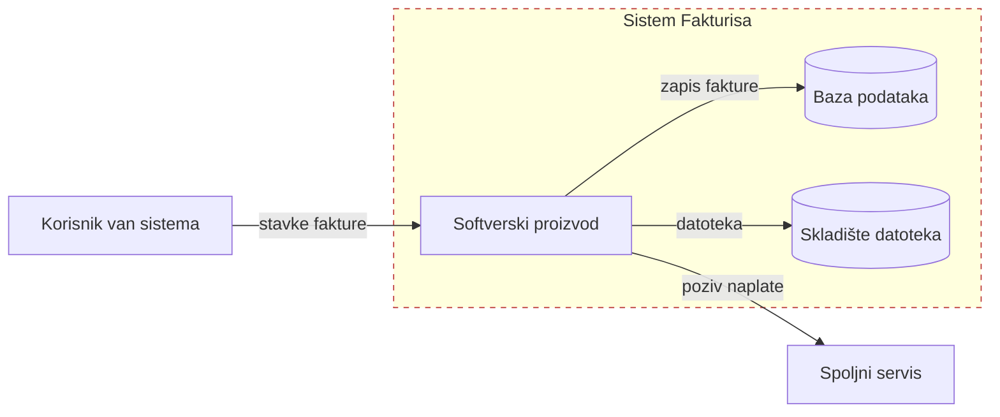
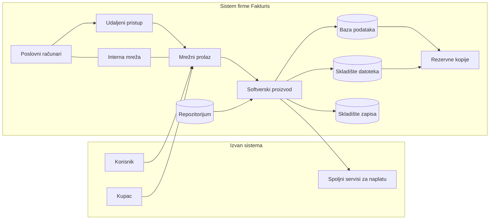

# Fakturis d.o.o.

Fakturis d.o.o. je studija slučaja, ne uslov definicija. To je malo preduzeće koje razvija i koristi sopstveni [[Softverski proizvod|softverski proizvod]]: korisnici izdaju fakture, vode kupce i naplaćuju ih. Firma ima dvadesetak zaposlenih.

Skica se može menjati, nadograđivati i uprošćavati kako projekat napreduje. Detalji studije ne ulaze u definicije pojmova.

Podela na komponente je logička: proizvod, server i baza imaju različite uloge i kada se nalaze na istoj mašini.

## Elementi

### Resursi
Klase resursa, bez popisa polja i putanja:

- podaci korisnika i njihovih kupaca
- fakture
- poslovni dokumenti firme
- izvorni kod proizvoda
- podešavanja, uključujući pristupne podatke spoljnih servisa
- evidencije naloga i prava pristupa
- zapisi o radu
- rezervne kopije

Resurs je i proces naplate, kao i poverenje korisnika.

### Ljudi
- **Jelena**, korisnička podrška
- **Stefan**, administrator sistema, jedini u firmi
- **Milan** i još pet programera
- **Dragan**, direktor, i knjigovođa
- čistač, zaposlen u firmi, bez pristupa resursima i bez poslovnog računara

Jelena, Stefan, programeri, direktor i knjigovođa su [[Zaposleni sa pristupom|zaposleni sa pristupom]].

### Komponente sistema
- [[Zaposleni]] i, kao ljudska komponenta, [[Zaposleni sa pristupom]].
- [[Poslovni računar|Poslovni računari]] koje firma dodeljuje zaposlenima sa pristupom. Isti laptop koristi se i u firmi i od kuće.
- [[Mrežni prolaz]], ruter i zaštitni zid, između firme i interneta.
- [[Interna mreža]], preklopnik i Wi-Fi, na koju su povezani računari i serveri u firmi. Isti Wi-Fi koriste i posetioci. Kućna mreža nije interna mreža.
- [[Udaljeni pristup]], preko kojeg poslovni računar van interne mreže stiže do ostalih komponenti.
- [[Server|Serveri]] u firmi. Na aplikacionom serveru izvršava se proizvod. Posebni serveri drže skladište datoteka, repozitorijum i rezervne kopije.
- [[Softverski proizvod]]. Oblik (jedan program ili više delova) i protokol nisu fiksni. Poziv [[Spoljni servis|spoljnog servisa]] za naplatu treba da bude deo proizvoda, na primer posebna klasa, a ne posebna komponenta.
- [[Skladište podataka]] je vrsta, ne jedan sistem sa kojim proizvod razgovara. Konkretna skladišta su [[Baza podataka]] (PostgreSQL, na aplikacionom serveru), [[Skladište datoteka]] (mrežni uređaj sa fakturama i dokumentima), [[Skladište zapisa]] i [[Repozitorijum izvornog koda]].
- [[Repozitorijum izvornog koda]], interni GitLab, skladište podataka u kojem stoji kod. Izmene ostaju u istoriji, proveravaju se i objavljuju na aplikacioni server.
- [[Sistem za rezervne kopije]], poseban server. Noću kopira bazu i skladište datoteka, nedeljno podešavanja servera, i čuva kopije 30 dana. Nije skladište podataka.
- [[Sistem za upravljanje nalozima]]: direktorijum naloga zaposlenih, i nalozi korisnika proizvoda u bazi.
- [[Sistem za zapise o radu]], nije izdvojen. Proizvod, server i mrežni prolaz upisuju zapise svaki u svoje skladište zapisa. Zapisi proizvoda čuvaju se sedam dana i niko ih redovno ne pregleda. Moguće ga je konkretizovati kao SIEM (Security Information and Event Management): jedan sistem koji skuplja zapise sa više komponenti i omogućava njihov pregled.

### Spolja
- korisnici proizvoda i njihovi kupci
- dva [[Spoljni servis|spoljna servisa]] za naplatu, iste namene, oba tuđe firme. Proizvod ih poziva iz dela koji je njegov kod, na primer iz posebne klase. Ako jedan ne odgovori, zove drugi. Podaci o kartici ne ulaze u sistem
- internet provajder, koji nije spoljni servis u smislu ove baze

### Poslovni procesi
1. Registracija i prijava korisnika.
2. Izdavanje fakture: zapis u bazi, datoteka u skladištu datoteka.
3. Naplata: proizvod, iz svog koda, poziva jedan od dva spoljna servisa.
4. Obrada korisničkog zahteva, Jelena.
5. Razvoj i objavljivanje nove verzije, iz repozitorijuma na aplikacioni server.
6. Upravljanje nalozima zaposlenih, Stefan.
7. Izrada rezervnih kopija i vraćanje podataka.
8. Rad sa poslovnim dokumentima.
9. Rad od kuće, preko udaljenog pristupa, na poslovnom računaru firme.

### Tokovi podataka
Ovo su [[Tok podataka|tokovi podataka]], ne samo spisak veza. [[Softverski proizvod]] je pri izdavanju fakture [[Procesna jedinica|procesna jedinica]].

Korisnici, njihovi kupci i servisi za naplatu su [[Spoljni entitet|spoljni entiteti]] u ovom modelu. Granica poverenja obuhvata komponente koje kontroliše Fakturis; tokovi između njih i spoljašnjih entiteta prelaze tu granicu.

- Korisnik i kupac, preko interneta i mrežnog prolaza, stižu do proizvoda.
- Proizvod čita i menja [[Baza podataka|bazu]] i upisuje datoteke u [[Skladište datoteka|skladište datoteka]]. Ne razgovara sa skladištem podataka kao jednim sistemom.
- Proizvod poziva spoljni servis za naplatu iz svog koda.
- Zaposleni sa pristupom, sa poslovnog računara na internoj mreži, radi u proizvodu i u skladištu datoteka.
- Isti računar van interne mreže koristi udaljeni pristup. Taj saobraćaj prolazi kroz mrežni prolaz.
- Programeri šalju izmene u repozitorijum, odakle se nova verzija objavljuje na aplikacioni server.
- Baza i skladište datoteka kopiraju se na sistem za rezervne kopije.
- Proizvod, server i mrežni prolaz upisuju zapise u svoja skladišta zapisa.

Oznake HTTP, HTTPS, DNS, SSH, TCP, UDP, TLS, MQTT i FTP u primerima pojmova služe da objasne uloge protokola. One ne određuju stvarnu konfiguraciju Fakturisovog proizvoda, koja u ovoj studiji nije fiksirana. Dodatni učesnici ili komponente u primerima, poput DNS servera, MQTT posrednika, FTP servera ili druge [[Procesna jedinica|procesne jedinice]], služe samo za objašnjenje protokola i nisu utvrđeni elementi osnovne studije.

Primer [[Dijagram toka podataka|dijagrama toka podataka]] za izdavanje fakture. Strelica je tok podataka. Isprekidani okvir označava granicu poverenja oko sistema Fakturisa. Baza i skladište datoteka su skladišta podataka. Rezervne kopije nisu.

Pregled komponenti, ne dijagram toka podataka. Cilindri su skladišta podataka. Rezervne kopije su posebna komponenta.

## Napomena
Ova beleška je skica za istraživanje teme. Može se menjati, nadograđivati i uprošćavati zavisno od napretka projekta. Konkretne ranjivosti i bezbednosni zahtevi dopisuju se kad zatrebaju, a ne unapred kao popis.
