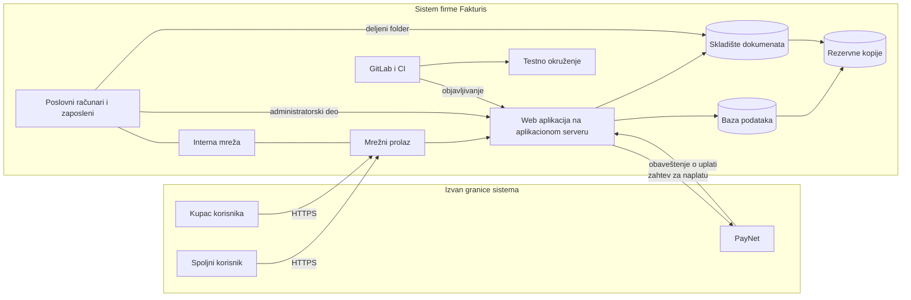

# Fakturis d.o.o.

Fakturis d.o.o. je malo preduzeće iz Novog Sada sa dvadesetak zaposlenih. Razvija i održava sopstvenu web aplikaciju **Fakturis**, preko koje preduzetnici i male firme izdaju fakture, vode evidenciju kupaca i naplaćuju fakture karticom. Aplikacija ima oko 3.000 korisničkih naloga. Naplata se obavlja preko spoljnog platnog servisa **PayNet**.

Kontekst je pogodan za temu jer na malom prostoru sadrži sve što preduzeće mora da štiti: osetljive podatke korisnika i njihovih kupaca, finansijske podatke čija tačnost ima pravne posledice, izvorni kod kao glavni proizvod, zavisnost od jednog spoljnog servisa i malu IT ekipu koja održava i aplikaciju i kancelariju.

Podela na komponente je logička: aplikacija, server i baza imaju različite uloge i kada se nalaze na istoj mašini.

## Elementi

### Resursi
Glavni resursi:
- **Korisnički podaci**: nalozi korisnika (e-mail, heš lozinke), podaci o firmi korisnika (naziv, PIB, adresa, tekući račun) i evidencija kupaca svakog korisnika.
- **Fakture**: zapisi u bazi (stavke, iznosi, status plaćanja) i PDF dokumenti koje aplikacija generiše.
- **Poslovni dokumenti firme**: ugovori sa korisnicima i partnerima, finansijski izveštaji, ponude.
- **Izvorni kod** aplikacije Fakturis sa istorijom izmena.

Prateći resursi:
- **Podešavanja sistema**, uključujući API ključ za PayNet.
- **Evidencije naloga i prava pristupa** zaposlenih i korisnika.
- **Zapisi o radu** (logovi) aplikacije, servera i rutera.
- **Rezervne kopije** baze, skladišta dokumenata i podešavanja.

Resurs je i **proces naplate faktura**, od kog firma zarađuje proviziju, kao i **poverenje korisnika** da su podaci o njihovom poslovanju zaštićeni.

### Ljudi i uloge
- **Jelena**, korisnička podrška: obrađuje zahteve korisnika, kroz administratorski deo aplikacije pregleda i ispravlja njihove podatke i radi sa ugovorima u skladištu dokumenata.
- **Stefan**, administrator sistema: održava servere, mrežu, naloge zaposlenih i rezervne kopije. Jedini je administrator u firmi.
- **Milan** i još pet programera: razvijaju aplikaciju, čuvaju izmene u repozitorijumu i objavljuju nove verzije.
- **Dragan**, direktor, i knjigovođa firme: rade sa ugovorima i finansijskim izveštajima.

### Komponente sistema
Dvanaest komponenti, grupisanih u šest celina. Svaka ima svoju belešku.

**1. Ljudi i radno okruženje**
- [[Zaposleni]] u ulogama iz prethodnog odeljka.
- [[Poslovni računar|Poslovni računari]]: laptopovi sa Windows 11, Microsoft Office paketom, web pregledačem i klijentom e-pošte. Programeri imaju i razvojne alate i lokalnu kopiju repozitorijuma.

**2. Mreža i komunikacija**
- [[Mrežni prolaz]]: jedan uređaj koji je ruter i zaštitni zid. Povezuje kancelariju sa internetom i propušta HTTPS saobraćaj ka aplikacionom serveru.
- [[Interna mreža]]: jedan mrežni preklopnik i jedna Wi-Fi pristupna tačka. Poslovni računari, serveri i Wi-Fi za posetioce nalaze se u istom segmentu. Lozinka za Wi-Fi zapisana je na tabli u sali za sastanke.

**3. Aplikacija i serversko okruženje**
- [[Server|Aplikacioni server]]: fizički server u server sobi sa Ubuntu Server operativnim sistemom i nginx web serverom. Na njemu rade i aplikacija i baza podataka.
- [[Web aplikacija]] Fakturis, sa tri dela:
  - korisnički deo: registracija, prijava, izdavanje faktura, evidencija kupaca;
  - javna stranica za plaćanje fakture, kojoj kupac pristupa preko linka iz e-pošte, bez prijave;
  - administratorski deo za zaposlene u podršci.

  Web frontend sa backendom komunicira preko REST API-ja. Za generisanje PDF faktura aplikacija koristi biblioteku PdfGen 2.3.
- Veza sa PayNet-om, kao deo web aplikacije: aplikacija šalje PayNet-u zahtev za naplatu potpisan API ključem, a PayNet javlja ishod plaćanja slanjem obaveštenja na adresu aplikacije `/api/paynet/obavestenje`. Podaci o karticama ne ulaze u sistem Fakturisa.

**4. Čuvanje podataka**
- [[Baza podataka]] (PostgreSQL) sa nalozima korisnika, podacima o njihovim firmama, kupcima, fakturama i statusima plaćanja.
- [[Skladište dokumenata]]: mrežno skladište (NAS) u server sobi. Sadrži PDF fakture koje generiše aplikacija i poslovne dokumente firme. Zaposleni mu pristupaju kao deljenom folderu `\\nas\dokumenti`.

**5. Razvoj i održavanje**
- [[Repozitorijum izvornog koda]]: interni GitLab server u server sobi.
- Uz repozitorijum: testno okruženje, virtuelna mašina sa kopijom produkcione baze na kojoj se izmene proveravaju, i GitLab CI cevovod koji posle uspešnih testova postavlja novu verziju na aplikacioni server.

**6. Zajedničke funkcije zaštite i podrške**
- [[Sistem za upravljanje nalozima]]: centralni direktorijum naloga zaposlenih, koji se koristi za prijavu na računare, skladište dokumenata i GitLab, i nalozi korisnika aplikacije, koji se vode u bazi.
- [[Sistem za zapise o radu]]: još nije izdvojen. Aplikacija, nginx i ruter vode zapise svako na svom uređaju.
- [[Sistem za rezervne kopije]]: server za rezervne kopije u istoj server sobi. Svake noći kopira bazu i skladište dokumenata, a jednom nedeljno podešavanja servera. Kopije se čuvaju 30 dana u deljenom folderu kome se pristupa Stefanovim administratorskim nalogom.

**Fizičko okruženje**
- Kancelarija na jednom spratu poslovne zgrade. Server soba je ormar u hodniku pored kuhinje. Ulaz u kancelariju je na ključ.

### Spoljni subjekti (izvan granice sistema)
- Spoljni korisnici, preduzetnici i male firme, sa svojim uređajima.
- Kupci korisnika, koji primaju fakturu i plaćaju je na javnoj stranici za plaćanje.
- PayNet, platni servis kojim upravlja druga firma.
- Internet provajder.

### Poslovni procesi
1. **Registracija i prijava korisnika.** Korisnik otvara nalog e-mailom i lozinkom i prijavljuje se u aplikaciju.
2. **Izdavanje fakture.** Korisnik unosi kupca i stavke, aplikacija upisuje fakturu u bazu, generiše PDF, čuva ga u skladištu dokumenata i kupcu šalje link ka stranici za plaćanje.
3. **Naplata fakture.** Kupac na stranici za plaćanje unosi karticu, aplikacija šalje zahtev PayNet-u, PayNet javlja ishod, aplikacija menja status fakture u „plaćeno“ i obaveštava korisnika.
4. **Obrada korisničkog zahteva.** Korisnik šalje zahtev podršci e-poštom ili telefonom, Jelena ga obrađuje kroz administratorski deo aplikacije.
5. **Razvoj i objavljivanje nove verzije.** Programer čuva izmenu u repozitorijumu, CI je proverava u testnom okruženju i postavlja na aplikacioni server.
6. **Upravljanje nalozima zaposlenih.** Stefan otvara naloge novim zaposlenima i gasi naloge onima koji odlaze.
7. **Izrada rezervnih kopija i oporavak.** Noćna izrada kopija i vraćanje podataka posle kvara ili napada.
8. **Rad sa poslovnim dokumentima.** Rukovodstvo, podrška i knjigovođa rade sa ugovorima i izveštajima u skladištu dokumenata.

### Glavni tokovi podataka
- Spoljni korisnik i kupac preko interneta i mrežnog prolaza pristupaju web aplikaciji (HTTPS).
- Web aplikacija čita i menja podatke u bazi i upisuje PDF fakture u skladište dokumenata.
- Web aplikacija šalje zahteve za naplatu PayNet-u, a PayNet šalje obaveštenja o ishodu web aplikaciji. Oba toka prelaze granicu sistema.
- Zaposleni preko poslovnog računara i interne mreže pristupaju administratorskom delu aplikacije i skladištu dokumenata.
- Programeri šalju izmene u repozitorijum, odakle CI postavlja novu verziju u testno okruženje, pa na aplikacioni server.
- Baza i skladište dokumenata se svake noći kopiraju na server za rezervne kopije.

### Bezbednosni zahtevi
Resurs × bezbednosno svojstvo. Crtica znači da svojstvo nije bitno za taj resurs.

| Resurs | Poverljivost | Integritet | Dostupnost | Neporecivost |
|---|---|---|---|---|
| Fakture | vide ih samo korisnik koji ih je izdao i kupac kome su upućene | menja ih samo korisnik koji ih je izdao; status „plaćeno“ postavlja samo potvrđeno obaveštenje PayNet-a | korisnik ih izdaje u svako doba, posebno poslednjih dana u mesecu | zna se ko je fakturu izdao, izmenio ili stornirao |
| Korisnički podaci | vidi ih vlasnik naloga, a podrška samo kada obrađuje njegov zahtev | menja ih vlasnik naloga ili podrška na njegov zahtev | dostupni pri prijavi i izdavanju fakture | zna se ko je promenio e-mail ili tekući račun |
| Poslovni dokumenti | vide ih rukovodstvo i zaposleni kojima su dodeljeni | menja ih autor dokumenta | dostupni zaposlenima u radno vreme | - |
| Izvorni kod | vide ga samo programeri firme | u glavnu granu ulazi samo izmena koju je pregledao drugi programer | dostupan za objavljivanje nove verzije | zna se ko je uneo svaku izmenu |
| API ključ za PayNet | znaju ga samo aplikacioni server i administrator | menja ga samo administrator | - | - |
| Rezervne kopije | pristupa im samo administrator | ne menja ih niko osim procesa izrade | podaci se vraćaju u roku od četiri sata | - |
| Proces naplate | - | - | radi neprekidno | - |

## Trenutno stanje zaštite
Opis stanja od kog firma polazi. Služi kao zajednička osnova za primere ranjivosti i kontrola.

### Postojeće kontrole
- Zaštitni zid na mrežnom prolazu propušta ka aplikacionom serveru samo HTTPS.
- Saobraćaj između korisnika i aplikacije je šifrovan (HTTPS).
- Lozinke korisnika čuvaju se kao heš (bcrypt).
- Rezervne kopije se prave svake noći.
- Na poslovnim računarima je uključen Microsoft Defender.

### Poznate ranjivosti
Po komponentama. Prva stavka uz svaku komponentu je glavna. Kolona „Vrsta“ je radni naziv za koleginu prezentaciju. Na ovoj grani te vrste nisu pojmovi i nemaju beleške.

| Komponenta | Šta je u Fakturisu | Vrsta (nije pojam na ovoj grani) | Ugroženi zahtev |
|---|---|---|---|
| [[Zaposleni]] | Jelena otvara priloge iz e-pošte bez provere pošiljaoca i menja podatke naloga na osnovu telefonskog poziva | podložnost socijalnom inženjeringu | programe na računaru instalira samo administrator; korisničke podatke menja vlasnik naloga |
| [[Poslovni računar]] | makroi u Office dokumentima sa interneta su dozvoljeni | pogrešna bezbednosna konfiguracija | programe na računaru instalira samo administrator |
| [[Poslovni računar]] | zaposleni rade kao lokalni administratori | prekomerno ovlašćenje | programe na računaru instalira samo administrator |
| [[Poslovni računar]] | Windows se ne ažurira automatski | nezakrpljen softver | programe na računaru instalira samo administrator |
| [[Mrežni prolaz]] | administratorski panel rutera dostupan je sa interneta, sa fabričkom lozinkom | pogrešna bezbednosna konfiguracija | podešavanja mreže menja samo administrator |
| [[Interna mreža]] | poslovni računari, serveri i Wi-Fi za posetioce su u istom segmentu | nedostatak segmentacije mreže | serverima pristupaju samo administrator i aplikacija |
| [[Server]] | Ubuntu i nginx nisu ažurirani od marta, a za verziju nginx-a postoji javno objavljena slabost | nezakrpljen softver | podešavanja servera menja samo administrator |
| [[Server]] | nginx u porukama o greškama prikazuje verziju i putanje fajlova | pogrešna bezbednosna konfiguracija | podešavanja servera vidi samo administrator |
| [[Web aplikacija]] | `/api/fakture/{id}` vraća fakturu svakom prijavljenom korisniku, bez provere da li je njegova | neispravna kontrola pristupa | fakture vide samo izdavalac i kupac |
| [[Web aplikacija]] | obaveštenje o uplati prihvata se bez provere potpisa PayNet-a | nedovoljna provera autentičnosti podataka | status „plaćeno“ postavlja samo potvrđeno obaveštenje PayNet-a |
| [[Web aplikacija]] | stranica za plaćanje ne ograničava broj pokušaja plaćanja, a prijava broj pokušaja prijave | nekontrolisana učestalost zahteva | proces naplate radi neprekidno |
| [[Web aplikacija]] | pretraga kupaca ugrađuje tekst pretrage direktno u SQL upit | injekcija | korisnik vidi i menja samo svoje kupce |
| [[Web aplikacija]] | polje „napomena“ prikazuje se na stranici za plaćanje bez kodiranja, pa se u njega može ubaciti skripta | injekcija | stranicu za plaćanje menja samo aplikacija |
| [[Web aplikacija]] | biblioteka PdfGen 2.3 preko adrese slike u HTML šablonu čita fajlove sa servera, a korisnik može da doda logo preko adrese slike | nezakrpljen softver | podešavanja servera vidi samo administrator |
| [[Web aplikacija]] | API ključ za PayNet ima i pravo povraćaja novca, iako ga aplikacija ne koristi | prekomerno ovlašćenje | povraćaj novca odobrava samo direktor |
| [[Baza podataka]] | aplikacija se povezuje na bazu kao njen vlasnik | prekomerno ovlašćenje | aplikacija ne briše tabele |
| [[Skladište dokumenata]] | svi zaposleni imaju pravo čitanja i pisanja nad celim deljenim folderom, uključujući finansijske izveštaje | prekomerno ovlašćenje | finansijske izveštaje vide rukovodstvo i knjigovođa; dokumente menja autor |
| [[Repozitorijum izvornog koda]] | produkcioni API ključ za PayNet upisan je u `config/paynet.yml` | ugrađeni pristupni podatak | API ključ znaju samo aplikacioni server i administrator |
| [[Repozitorijum izvornog koda]] | testno okruženje koristi kopiju produkcione baze sa pravim podacima korisnika | prekomerno ovlašćenje | korisničke podatke vide samo vlasnik naloga i podrška |
| [[Sistem za upravljanje nalozima]] | prijava na GitLab i administratorski deo aplikacije samo lozinkom; Stefan za GitLab koristi lozinku koja je procurela sa jednog foruma | slaba autentifikacija | izvorni kod vide samo programeri firme; administratorskom delu pristupa samo podrška |
| [[Sistem za upravljanje nalozima]] | nalog programera koji je otišao pre dva meseca i dalje je aktivan u GitLab-u | prekomerno ovlašćenje | izvorni kod vide samo programeri firme |
| [[Sistem za zapise o radu]] | aplikacija beleži samo greške, ne i prijave, storniranja i promene statusa; zapisi se ne pregledaju | nedovoljno beleženje i praćenje | zna se ko je fakturu stornirao |
| [[Sistem za rezervne kopije]] | kopije su u istoj mreži, dostupne Stefanovim nalogom čiji su podaci sačuvani na Jeleninom laptopu, nešifrovane, a vraćanje nikad nije probano | nezaštićena rezervna kopija | podaci se vraćaju u roku od četiri sata |
| Fizičko okruženje | server ormar u hodniku nije zaključan | nedostatak fizičke zaštite | serverima fizički pristupa samo administrator |
