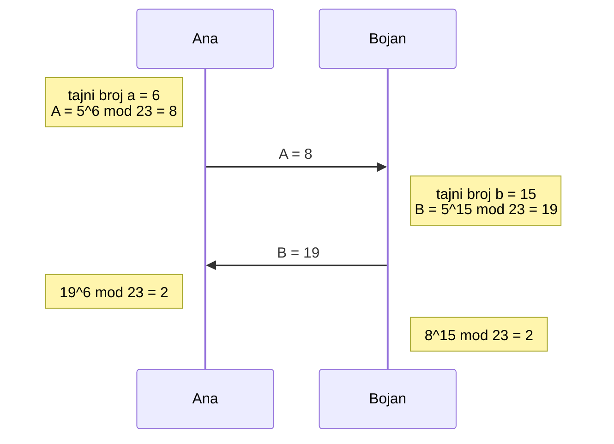

# Diffie-Hellman razmena ključeva (Diffie-Hellman key exchange)

## Definicija
Diffie-Hellman razmena ključeva je [[Protokol|protokol]] u kojem svaka od dve strane izabere tajni broj (a, odnosno b), pošalje drugoj javnu vrednost g^a, odnosno g^b, i iz primljene vrednosti i svog tajnog broja izračuna istu zajedničku tajnu g^ab, koju posmatrač iz g^a i g^b ne može da izračuna (problem diskretnog logaritma).

## Primer
Sa malim brojevima, samo radi ilustracije: javno su dogovoreni p = 23 i g = 5.

Posmatrač vidi p, g i ono što ide strelicama (8 i 19). Da bi dobio 2, mora da pronađe a ili b (problem diskretnog logaritma); sa brojevima od 2048 bita to nije izvodljivo.

## Napomene
- Danas se umesto brojeva po modulu koriste tačke [[Kriptografija eliptičkih krivih|eliptičke krive]]; postupak je isti, samo se umesto g^a računa a·G. Javne vrednosti X25519 imaju po 32 bajta, a sam X25519 se u [[TLS|TLS-u]] danas obično koristi u hibridu sa [[Mehanizam enkapsulacije ključa#ML-KEM|ML-KEM-om]] ([[Hibridna razmena ključeva]]).
- Kada se za svaku vezu prave nove tajne vrednosti (oznaka E, „ephemeral“: DHE, ECDHE), dobija se [[Savršena tajnost unapred]].
- Iz zajedničke tajne ključevi se izvode [[Funkcija za izvođenje ključa|KDF-om]].
- Kvantni računar razbija DH; zamena je [[Mehanizam enkapsulacije ključa|KEM]] ([[Mehanizam enkapsulacije ključa#ML-KEM|ML-KEM]]), uvodi se [[Hibridna razmena ključeva|hibridno]].

## Česti propusti i zaštita
- **Razmena bez autentifikacije.** Sam DH ne kaže sa kim je tajna dogovorena. Napadač na putanji izvede jednu razmenu sa Anom, drugu sa Bojanom i prosleđuje, čitajući sve: [[Napad posrednikom|napad posrednikom]]. *Zaštita:* server potpisuje razmenu ključem iz proverenog [[Digitalni sertifikat|sertifikata]], kao u TLS-u.
- **Slabe grupe.** Logjam (2015) je [[Napad degradiranjem verzije|degradiranjem verzije]] terao servere na „izvozne“ DH grupe od 512 bita, koje su se razbijale. *Zaštita:* grupe od bar 2048 bita (RFC 7919) ili X25519.
- **Neproverena javna vrednost** kod ECDH omogućava napad nevažećom krivom, kojim napadač deo po deo izvlači privatni ključ ([[Kriptografija eliptičkih krivih]]). *Zaštita:* provera da primljena tačka leži na krivoj, ili X25519.
