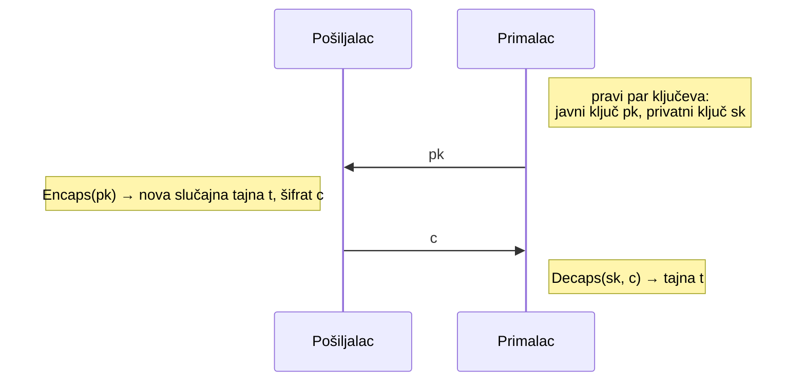

# Mehanizam enkapsulacije ključa (key encapsulation mechanism, KEM)

## Definicija
Mehanizam enkapsulacije ključa je [[Asimetrična kriptografija|asimetrični]] algoritam sa tri operacije: pravljenje para ključeva; enkapsulacija, kojom pošiljalac pomoću javnog ključa primaoca dobija slučajnu zajedničku tajnu i njen šifrat; i dekapsulacija, kojom primalac iz šifrata svojim privatnim ključem dobija istu tajnu.

## Primer

Posmatrač vidi pk i c, ali bez sk ne dobija t. Obe strane zatim iz t izvode ključeve.

Pošiljalac ne bira tajnu; KEM je pravi sam. Zato kod KEM-a ne postoji greška tipa Bleichenbacherovog napada na RSA, koja nastaje u paddingu poruke koju bira pošiljalac ([[RSA]]).

## Napomene
- [[Diffie-Hellman razmena ključeva|DH]] se može zapisati kao KEM: privremena javna vrednost pošiljaoca je šifrat (DHKEM u RFC 9180).
- Postkvantno uspostavljanje ključa standardizovano je kao KEM (ML-KEM), pa je KEM zajednički interfejs koji olakšava zamenu algoritama ([[Kriptografska agilnost]]).
- Iz tajne se ključevi izvode [[Funkcija za izvođenje ključa|KDF-om]]; KEM plus simetrično šifrovanje čine [[Hibridno šifrovanje|hibridno šifrovanje]].

## ML-KEM
ML-KEM je [[Postkvantna kriptografija|postkvantni]] mehanizam enkapsulacije ključa standardizovan kao NIST FIPS 203, čija bezbednost počiva na problemu učenja sa greškama nad modulskim rešetkama (Module-LWE).

U TLS-u se ML-KEM koristi zajedno sa X25519, u [[Hibridna razmena ključeva|hibridnoj razmeni ključeva]]: pregledač za svaku vezu pravi nov ML-KEM par ključeva i šalje javni ključ, server enkapsulira tajnu i vraća šifrat.

- **Intuicija.** Sistem linearnih jednačina lako se rešava. Ako se svakoj jednačini doda mala slučajna greška, a sve računa po modulu, rešavanje postaje teško, prema današnjem znanju i za kvantni računar. Javni ključ je takav sistem „jednačina sa šumom“, a privatni ključ njegovo rešenje.
- Skupovi parametara ML-KEM-512, -768 i -1024 odgovaraju NIST kategorijama 1, 3 i 5 (približno jačini AES-128, -192 i -256). Uobičajen je ML-KEM-768: javni ključ ima 1184 bajta, šifrat 1088 bajtova, a zajednička tajna 32 bajta.
- Pre standardizacije zvao se CRYSTALS-Kyber, kraće Kyber, i pod tim imenom se i danas često pominje. Tokom standardizacije je izmenjen, pa Kyber iz treće runde i ML-KEM nisu međusobno kompatibilni.

## Česti propusti i zaštita
- **Pretpostavka da KEM autentifikuje pošiljaoca.** Šifrat može da napravi svako ko ima javni ključ. *Zaštita:* kada je pošiljalac bitan, dodaje se potpis ili autentifikovani režim (HPKE Auth).
- **Implementacija ML-KEM-a koja nije u konstantnom vremenu** ([[Napad merenjem vremena]]). KyberSlash (2023–2024): deljenje zavisno od tajnih podataka u više implementacija Kyber-a, uključujući referentnu, omogućavalo je izvlačenje ključa merenjem vremena. *Zaštita:* proverene, ažurirane biblioteke, ne sopstvena implementacija.
