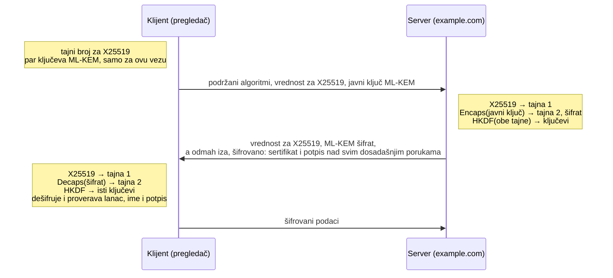

# TLS (Transport Layer Security)

## Definicija
TLS je [[Protokol za zaštitu komunikacije|protokol za zaštitu komunikacije]] koji između [[Klijentski program|klijenta]] i [[Serverski program|servera]] uspostavlja kanal u kojem je server, a po potrebi i klijent, autentifikovan, a podaci zaštićeni od čitanja i izmene.

## Primer
Proces rukovanja (handshake) u TLS 1.3 pri otvaranju `https://example.com`, sa današnjom hibridnom razmenom ključeva, traje jedno putovanje poruka i povezuje većinu kriptografskih pojmova iz baze:



Delovi rukovanja: [[Diffie-Hellman razmena ključeva|X25519]] i [[Mehanizam enkapsulacije ključa#ML-KEM|ML-KEM]] ([[Hibridna razmena ključeva]]), [[Funkcija za izvođenje ključa|HKDF]], [[Digitalni sertifikat|sertifikat]] i lanac do korena ([[Digitalni sertifikat#Infrastruktura javnih ključeva|PKI]]), [[Digitalni potpis|potpis]]. Sve što je na dijagramu označeno kao šifrovano, od sertifikata nadalje, šifruje se [[Autentifikovano šifrovanje|AEAD-om]] (AES-GCM ili ChaCha20-Poly1305) ključevima izvedenim iz obe tajne.

## Napomene
- HTTPS je HTTP preko TLS-a; TLS štiti i e-poštu, veze ka bazama i MQTT.
- Kod međusobnog TLS-a (mTLS) i klijent pokazuje sertifikat; koristi se najčešće između servisa, kada server mora da zna koji ga program poziva.
- TLS štiti samo deonicu između dve tačke. Ako se TLS veza završava na uređaju ispred servera, npr. na balanseru opterećenja (load balancer), deonica od njega do servera štiti se posebno.

## TLS 1.2 i šta je 1.3 promenio
TLS 1.2 (2008) je i danas dozvoljen i raširen; TLS 1.0 i 1.1 se ne smeju pregovarati (RFC 9325). Proces rukovanja traje dva putovanja poruka, a algoritmi se biraju kao **paket kriptografskih algoritama** (cipher suite), čiji naziv redom navodi razmenu ključeva, potpis, šifrovanje i heš:

```text
TLS_ECDHE_RSA_WITH_AES_128_GCM_SHA256
    ECDHE         razmena ključeva, efemerna → tajnost unapred
    RSA           potpis servera, ključ iz sertifikata
    AES_128_GCM   simetrično autentifikovano šifrovanje
    SHA256        heš u funkciji za izvođenje ključeva (PRF zasnovan na HMAC-u)
```

U TLS 1.2 svaki od ova četiri dela mogao je da bude slab, pa se većina poznatih napada na TLS vezuje za njega:

| Mogućnost u TLS 1.2 | Problem | Napad | U TLS 1.3 |
| --- | --- | --- | --- |
| razmena `RSA` (klijent šifruje tajnu javnim ključem servera) | nema [[Savršena tajnost unapred\|tajnosti unapred]]; padding PKCS#1 v1.5 | Bleichenbacher ([[RSA]]) | uklonjena |
| „izvozni“ algoritmi od 512 bita | razbijaju se | FREAK, Logjam ([[Napad degradiranjem verzije]]) | uklonjeni |
| CBC sa MAC-om pre šifrovanja | razlika u obradi neispravne dopune (padding) | padding oracle, Lucky Thirteen (2013) ([[Blokovska šifra]]) | samo AEAD |
| kompresija na nivou TLS-a | dužina šifrata otkriva sadržaj | CRIME (2012), krađa kolačića sesije | uklonjena |

U TLS 1.3 naziv paketa sadrži samo AEAD i heš (npr. `TLS_AES_128_GCM_SHA256`); razmena ključeva i algoritam potpisa dogovaraju se odvojeno, i među njima više nema slabih mogućnosti iz tabele.

TLS 1.2 podešen prema RFC 9325 (samo ECDHE i AEAD paketi) nema slabosti iz tabele; TLS 1.3 iste izbore nameće bez podešavanja.

## Česti propusti i zaštita
- **Uklanjanje TLS-a (SSL stripping).** Korisnik ukuca `example.com`, pregledač prvo pokuša HTTP; napadač na javnom Wi-Fi-ju zadrži korisnika na HTTP-u, a sa serverom sam razgovara preko HTTPS-a. *Zaštita:* preusmeravanje na HTTPS i zaglavlje HSTS, kojim server nalaže pregledaču da domen otvara samo preko HTTPS-a.
- **Server dozvoljava sve što klijent ponudi**, uključujući stare verzije i pakete algoritama, pa je ranjiv [[Napad degradiranjem verzije|degradiranjem verzije]]. *Zaštita:* samo TLS 1.2 i 1.3, za TLS 1.2 samo ECDHE i AEAD paketi (RFC 9325); podešavanje se proverava alatom za skeniranje.
- **0-RTT podaci.** TLS 1.3 dozvoljava da klijent koji se ponovo povezuje pošalje podatke već u prvoj poruci, pre završetka rukovanja; napadač može da snimi takvu poruku i pošalje je ponovo. *Zaštita:* preko 0-RTT se ne prihvataju radnje koje menjaju stanje (npr. plaćanje).
